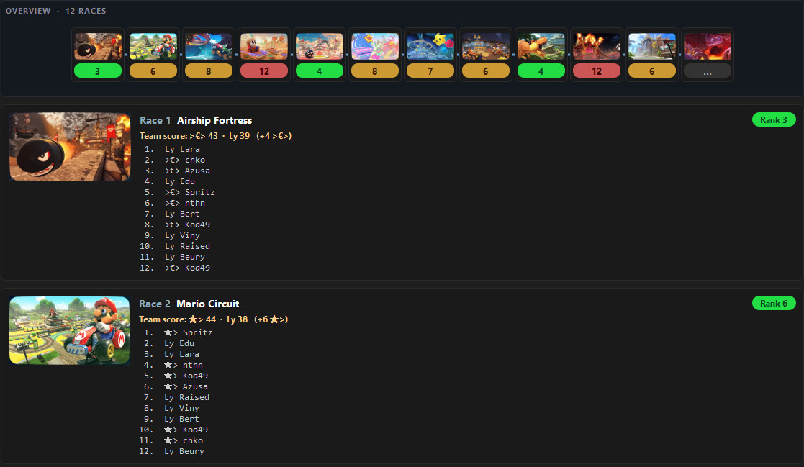
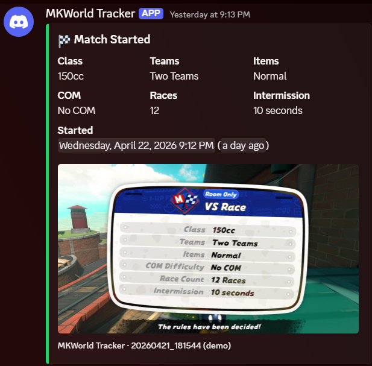
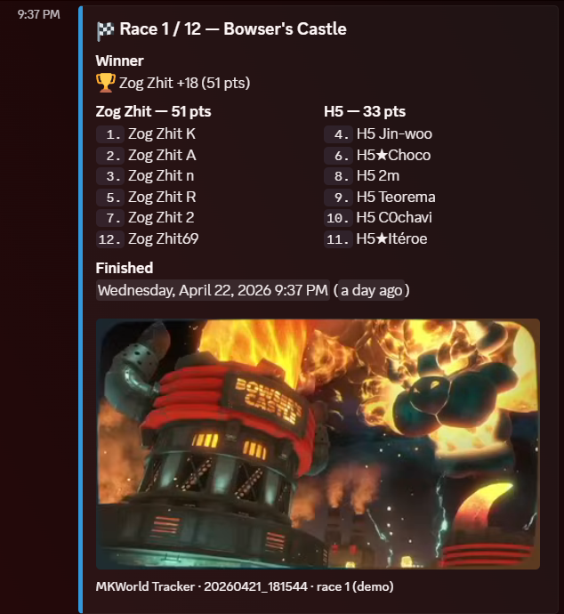

# MKWorld Tracker

A desktop app that watches your Switch capture card and automatically logs Mario Kart World matches (settings, tracks, players, race placements, and final standings) using a mix of computer vision, OCR, and the Gemini API.

This is intended to be used to track war and mogi data over a long period of time.

## Demo

**Match start detection**

https://github.com/user-attachments/assets/1bab91df-a4b8-4238-9d11-cdeda0bbe834

**Track selection**

https://github.com/user-attachments/assets/89d95382-ad98-4ff3-8d38-a708a3c63ebd

**Race results**

https://github.com/user-attachments/assets/c462f28f-29c9-477e-9c7b-23d69a2da6dd

**Team match scoring**

Per-race team scores and race winner are calculated automatically from the detected placements.



**Match end**

https://github.com/user-attachments/assets/d7ac429f-694b-42a3-90be-5c84c20f4a71

**Results table**

When a match ends, a result table is generated automatically from the final standings. The table is viewable in the Match History tab and can be copied to the clipboard or edited in place.


**Editing the results table**

If any names or scores were misread, the table can be edited directly from the Match History tab via the **Edit Table** button. The dialog a similar format to Lorenzi's table editor (team tag followed by `<name> <score>` rows, blank lines between teams); saving re-derives placements, regenerates the PNG, and updates the stored match record.


**Menu navigation**

https://github.com/user-attachments/assets/44d16668-a95c-4bb5-8190-1f4e8add526e

**Discord webhook notifications**

Live match updates can be sent to a Discord channel automatically via a Discord webhook. Once a webhook URL is configured, the app posts an embed at each key moment of a match — no manual interaction required.

Match start — posts the detected match settings along with a snapshot of the rules screen:



Race results — When the match is played in team mode, posts per-team placements, the race winner, and the point delta after every race:



Match end — posts the final standings with the generated results table attached as an image:


Each notification is individually configurable from the **Settings** tab. Paste your webhook URL, hit **Send Test** to confirm it's reachable, then toggle the checkboxes under **Webhook Events** to pick which moments get posted (match start, per-race results, match end).


## Features

- **Live game state detection**: This program will automatically detect when a match starts and track all information about the race, track selection, placements, etc. No manual interaction from you is needed.
- **Match settings recognition**: Auto-reads and adapts to the number of teams and race count and gives specialized info based on that.
- **Track detection**: Automatically recognizes each of the tracks being played.

The course catalog includes all 48 courses through game version 1.9.0: the
original 30, ten SNES courses from 1.8.0, and eight numbered variants from
1.9.0. Live detection, video analysis, and the match-history course picker share
this catalog. Course numbers are preserved during OCR matching. Added courses
display their names without artwork until dedicated icons are available.
- **Per-race placements**: Records the full finishing order after every race. This accounts for different team modes.
- **Final match standings**: Captures the final scores and standings at the end of every match automatically.
- **Persistent match history**: Every match you play is saved automatically and viewable later in a Match History tab, with a per-race breakdown.
- **Live match view**: Watch your in-progress match update live in the history tab as each race finishes.
- **Gemini integration (optional)**: A free Gemini API key can be used to drastically improve the detected names throughout the program.
- **Cross-platform support**: Works on Windows, macOS, and Linux with any USB capture card that delivers a 1920x1080 feed from your Switch.

## Prerequisites

### Capture card

The app reads frames from a USB capture card via the platform's native video backend (DirectShow on Windows, AVFoundation on macOS, V4L2 on Linux) and lets you pick the device from the source dropdown in the toolbar. Any card that can deliver a **1920x1080** feed from your Switch will work — the detection ROIs and OCR thresholds are tuned against that resolution.

### Tesseract OCR

The program utilizes the Tesseract binary for OCR. It must be installed separately prior to running this application.

- **Windows**: install via the [UB Mannheim build](https://github.com/UB-Mannheim/tesseract/wiki). The default install location (`C:\Program Files\Tesseract-OCR\`) is auto-detected. If you install it anywhere else, add that directory to your `PATH`.
- **macOS**: `brew install tesseract`
- **Linux**: `sudo apt install tesseract-ocr` (or your distro's equivalent)

If Tesseract is not on `PATH` and not at the default Windows location, the GUI will launch but OCR detection will throw `TesseractNotFoundError` on the first frame and the program becomes effectively unusable.

### Gemini API key (optional but strongly recommended)

The app uses a mix of OCR (via Tesseract) and Gemini models to detect game state. Tesseract handles the always-on detectors (match settings, track name, player names); Gemini, when configured, replaces OCR for race rank, race results, and final standings — all of which are noticeably more reliable with the LLM.

The Gemini models we use are **free** on Google AI Studio's free tier. Grab a key from [Google AI Studio](https://aistudio.google.com/app/apikey) and paste it into the **Settings** tab in the app; it'll be persisted to a local `.env` file. Without a key, the app still runs but falls back to OCR for everything.

Suggested models (configurable from the Settings tab):

- `gemma-4-31b-it` _(default)_ — newer, larger Gemma; better at recovering noisy or partially obscured frames at the cost of a bit more latency.
- `gemma-3-27b-it` — open-weights Gemma 3; a solid lighter-weight baseline that's accurate enough across all three tasks.
- `gemini-3.1-flash-lite-preview` — the best of the three when you can get it, but free-tier capacity is often exhausted during peak hours and requests will fail with a quota error until demand dies down. Worth trying first; fall back to one of the Gemma models if you start seeing rate-limit errors.

## Running

Live View and Video Review each have their own **Worldwides**, **Time Trial**,
and **Custom Room** mode selector. Both default to **Custom Room**, which uses the
existing match tracker. **Worldwides and Time Trial are planned features and
are not implemented.** Their selector options are placeholders; video can be
viewed, but neither mode has a tracking or analysis pipeline. The mode is
locked during an active custom-room match; use Reset State to end that session
before switching modes.

This modified version has been tested on Windows. macOS has not yet been
tested, including capture-card access and OCR setup.

Dependencies are managed with [uv](https://docs.astral.sh/uv/).

```bash
uv sync
uv run mktracker
```

### Recorded-video review

In **Custom Room**, **Race position** above the video reads the current frame's
HUD locally during playback and after seeking, including while paused. A dash
means the HUD is hidden or the shape is uncertain; the previous position is
not carried into menus or other frames. Faded indicators are checked with
additional low-saturation and brightness masks, with stricter shape agreement
to distinguish the numeral from its translucent outline and background. This
also works when seeking directly into a fade, without an earlier solid reading.
Fully invisible, heavily obscured or ambiguous indicators can still show a dash.
No API key or full-video rescan is
needed. This reader currently supports **1st–12th in the single-player,
full-screen layout** used by the supplied blue/red team recordings. Larger
rooms, split-screen and other HUD layouts need additional reference footage.
It is connected only to Video Review, not live tracking, and does not yet save
a position history to the timeline.

Open the **Video Review** tab, choose **Custom Room**, then **Open Video…** and select an MP4 (or another
OpenCV-supported video). Analysis starts locally in the background. The video
opens paused; use **Play/Pause** and the seek bar to review it while analysis
continues. Playback currently shows video only, without audio. No Gemini key is
required, and video analysis does not send webhooks.

**Live View** contains capture-device controls, live match settings, and live
tracking. **Video Review** contains the file player, analysis controls, and saved
race timeline. Opening a recording never resets live match tracking, and changing
capture devices never clears the video timeline. Switching away from Video Review
pauses recorded playback; return and press Play to continue. A video passed on
the command line opens directly in Video Review.

The timeline lists each detected course preview, finish, and result screen.
Click an entry once to pause and jump to that moment. Course preview timestamps
mark the map/player-list screen, not the starting gun. Boundaries are sampled
every half second. Player-name OCR is a draft and may be incomplete or wrong;
the result-screen entry lets you inspect the footage directly.

Selecting a timeline entry also shows that race's detected names in the results
panel. **Refresh Names** re-reads just the saved race result windows and updates
that panel, with progress counted by race. It keeps your race timestamps and
playback position. The local team-results reader isolates name and placement
columns, samples the scrolling table every half second, and combines repeated
readings. Decorative clan symbols and occasional similar letters can still be
misread; names remain OCR drafts.

Result comparison samples roughly four frames per second while the table is
visible. It gives clearer reads more weight, compares close spelling variants,
and counts an identical image only once. Several standings frames must agree
before result collection ends. Readings with insufficient or conflicting
evidence show **[review]**; hover over a name for its frame count and agreement.
Agreement describes consistency between OCR readings, not a probability that
the spelling is correct. Similar names actually seen together remain separate.

The reader also samples the course-preview player list across multiple frames.
That roster supports close spelling decisions and highlights result names that
do not clearly match a preview player. Preview OCR is checked rather than
treated as ground truth: ambiguous or missing matches stay marked for review,
and a roster name is never invented in a finishing row. Hover over the results
panel title to inspect the preview roster, or over a result name to see its
preview match.

### Game-font names and symbols

In **Settings → Game font**, select your local game TTF/OTF file. The optional
font recognizer builds templates from every visible character in its Unicode
map, including accented letters, Greek, Cyrillic, kana and private-use icons.
It compares multiple render sizes and component groups to recover unfamiliar
tags in course previews and team results. Strong shape matches can correct
OCR; ambiguous differences retain the original spelling and request review.
Visually equivalent characters (such as Latin/Greek capital A) share an
identity while retaining the OCR spelling. Distinct accents and symbols stay
separate. The results panel uses the supplied font to display custom icons.
Use **Refresh Names** to update previously saved readings.

Run `python scripts/audit_font_coverage.py --output analysis/font-audit --sizes 64,44,32`
to test every visible glyph in an unfamiliar tag. The supplied font has 748
visible glyphs: the current synthetic audit matches all at 64px and 44px, and
746 at 32px; the two small-size errors are rejected as ambiguous. This checks
rendered glyphs, not every possible compression, camera angle or background.

The font stays at the selected local path; its path is stored in the ignored
`.env` file as `GAME_FONT_PATH`. **Clear** disables font verification. Font
integration tests use that setting (or the environment variable of the same
name) and skip when no local reference font is available.

### OCR development probes

Run these from the repository root after installing the dependencies. They are
developer scripts, excluded from the installed application. Inputs and output
directories are explicit; generated files under `analysis/` are ignored by Git.

Inspect result names at selected recording timestamps (in seconds):

```bash
uv run python scripts/probe_names.py "gameplay.mp4" --times 243 244.5 --output analysis/names
```

This writes normalized screenshots, deskewed name-row sheets and `readings.json`
using the current custom-room team-result reader. The game font is optional.

Inspect every visible result row in a screenshot with the full-font recognizer:

```bash
uv run python scripts/probe_font_symbols.py "results.jpg" --font "game-font.ttf" --output analysis/glyphs
```

Omit `--font` to use the configured game font. Add `--rows 1 2 9` to inspect
specific one-based visible rows (not racer ranks). Output includes row images
and `glyphs.json` with shape scores, margins, visual alternatives and verification
flags. Unverified glyph predictions are diagnostic candidates, not accepted OCR
corrections. Both probes expect custom-room team result screens; other game
screens may contain no detectable rows.

Timelines are saved in `video_timelines/` and reload when the same file is opened
again. Changing the source file invalidates its cached timeline. **Analyze Video**
runs a fresh scan. Seeking never mutates the saved timeline. Videos that begin
mid-race may have an unknown course and a start marked as needing review.
Unknown course labels are left unresolved unless they match the course list or
a confidently read console-prefixed preset label.

You can also open a recording directly:

```powershell
uv run mktracker "C:\path\to\gameplay.mp4"
```

This workspace's installed environment is `.venv-app`. To run it directly on
Windows:

```powershell
.\.venv-app\Scripts\python.exe -m mktracker.main "C:\path\to\gameplay.mp4"
```

Or use `Start-Tracker.ps1`, which selects the installed environment and sets the
working directory so saved timelines are found consistently:

```powershell
.\Start-Tracker.ps1 "C:\path\to\gameplay.mp4"
```
